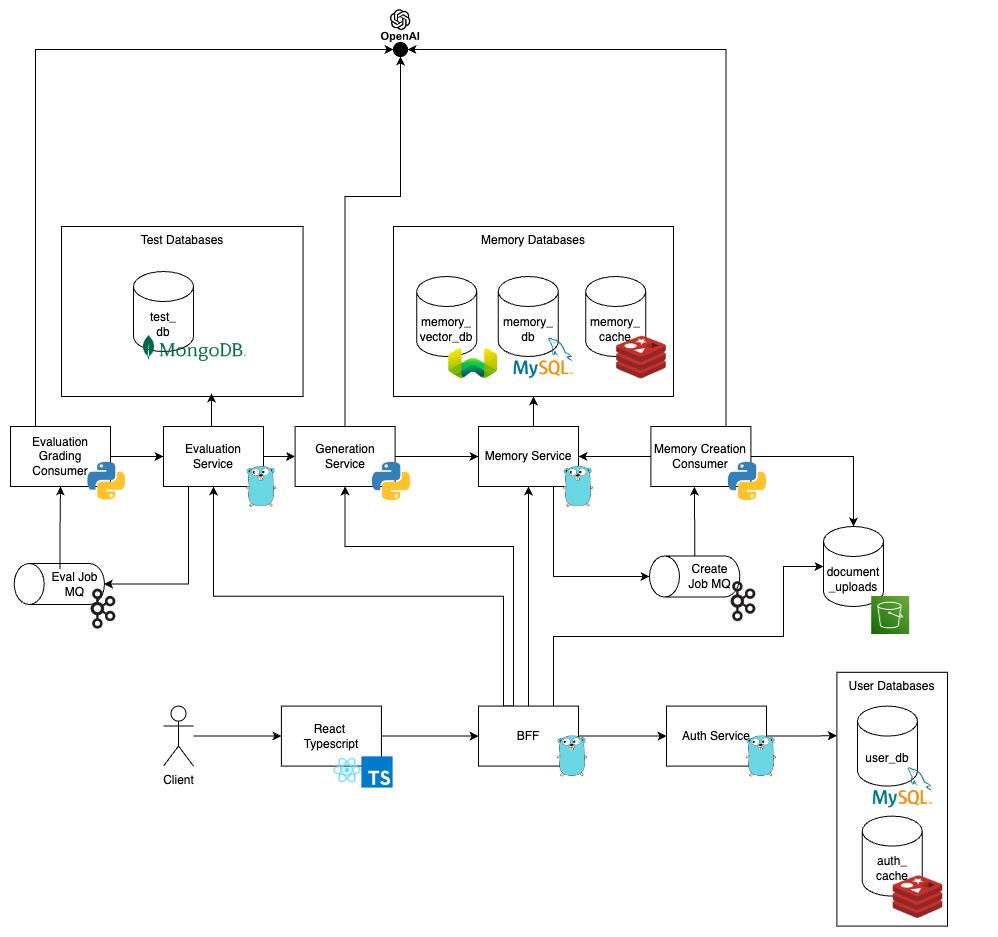
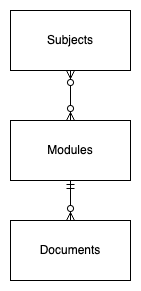
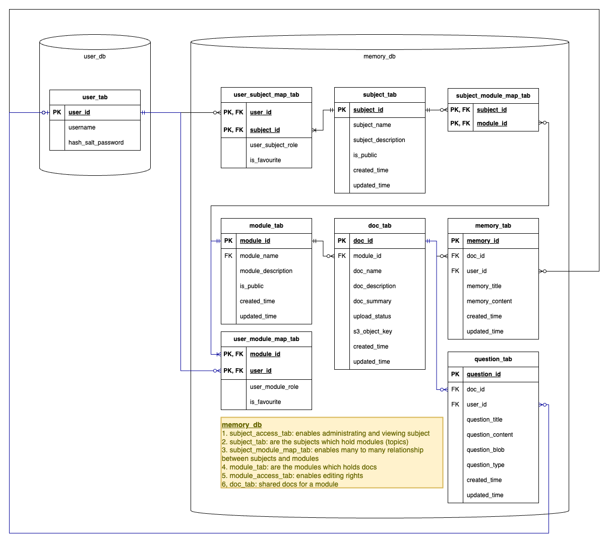

# Tutor AI

Tutor AI is a full-stack learning platform that turns uploaded course material into searchable study resources. Users organize PDFs into subjects and modules, the backend processes those documents asynchronously, and the app generates summaries, memory cards, quizzes, and retrieval-augmented chat over the resulting knowledge base.

The project is intentionally service-oriented: a React client talks to a Go Backend-for-Frontend over REST, the BFF fans out to internal gRPC services, Kafka decouples document ingestion, MySQL stores structured learning data, Redis backs sessions and cached access metadata, and Weaviate stores embedded memory chunks for scoped semantic retrieval.



## What It Does

- Authenticated learning workspace with user registration, login, and Redis-backed sessions.
- Subject and module organization with public/private discovery, favourites, search, and many-to-many subject-module mapping.
- PDF upload through the BFF to S3, followed by asynchronous document processing through Kafka.
- LLM-powered document summarization, memory extraction, and quiz generation from uploaded material.
- Multiple question formats, including single-answer MCQ, multi-answer MCQ, and open-answer questions stored as protobuf payloads.
- Retrieval-augmented chat over a selected document, module, or subject using vector prefilters.
- Docker Compose environment for the frontend, Go services, Python services, Kafka, MySQL, Redis, and Weaviate.

## Core Architecture

### Frontend

The client is a React + TypeScript Vite app using React Router, Redux Toolkit, Axios, Tailwind, and DaisyUI. It provides the user-facing workflows for authentication, exploring public and private subjects/modules, marking favourites, uploading documents, reviewing generated memories/questions, and chatting with document-backed context.

### Go BFF

The BFF exposes the browser-facing REST API with Gin. It owns HTTP concerns such as CORS, session middleware, multipart PDF upload, S3 object creation, request shaping, and response translation. Internally it calls the auth, memory, document, module, subject, question, and generation services over gRPC.

### Authentication Service

The authentication service is a Go gRPC service backed by MySQL and Redis. MySQL stores user credentials as salted bcrypt hashes, while Redis stores active sessions and supports distributed locking around authentication flows.

### Memory Service

The memory service is the primary Go domain service for subjects, modules, documents, generated memories, questions, and vector search. It stores relational state in MySQL, publishes document-processing jobs to Kafka, writes vectorized memory chunks to Weaviate, and enforces view/edit access checks around user-module relationships.

### Memory Creation Consumer

The Python consumer listens for `create_document` Kafka events. For each uploaded PDF, it downloads the source file from S3, converts it to Markdown with `pymupdf4llm`, summarizes large documents recursively when needed, generates study memories and quiz questions with the OpenAI API, and writes the generated artifacts back through the memory service's gRPC APIs.

### Generation Service

The Python generation service serves RAG chat over gRPC. It uses LangChain's conversational retrieval flow, a Weaviate-backed retriever, chat history, and entity-scoped filters so users can ask questions against a document, module, or subject instead of an unbounded global index.

## Data Model

Subjects, modules, and documents are modeled separately so the same module can be reused across multiple subjects without duplicating documents or generated content.



The relational schema stores:

- users and bcrypt password hashes in the auth database;
- subjects, modules, user ownership/favourite mappings, and subject-module mappings;
- documents with upload status and S3 object keys;
- generated memories with matching Weaviate vector UUIDs;
- generated questions as typed protobuf blobs.



## Document Processing Flow

1. The user uploads a PDF to a module from the React app.
2. The BFF uploads the file to S3 and asks the memory service to create a queued document record.
3. The memory service commits the document metadata in MySQL and publishes a `create_document` Kafka event.
4. The Python consumer downloads the PDF, extracts Markdown, summarizes the content, and generates study artifacts.
5. The consumer writes summaries, memory chunks, and questions back to the memory service.
6. The memory service persists relational records and creates corresponding Weaviate objects for semantic search.
7. The generation service retrieves scoped context from Weaviate when the user asks questions in chat.

## Tech Stack

| Layer | Technologies |
| --- | --- |
| Frontend | React, TypeScript, Vite, React Router, Redux Toolkit, Tailwind, DaisyUI, Axios |
| API Gateway | Go, Gin, gRPC clients, AWS SDK for S3 |
| Core Services | Go gRPC services for authentication, memory, documents, modules, subjects, and questions |
| Async Workers | Python, Kafka consumer, OpenAI API, LangChain, `pymupdf4llm` |
| Storage | MySQL, Redis, Weaviate, S3 |
| Messaging | Kafka + Zookeeper |
| Local Runtime | Docker Compose, Make |

## Running Locally

Prerequisites:

- Docker and Docker Compose
- `make`
- AWS credentials and an S3 bucket for uploaded PDFs
- OpenAI API key
- LlamaParse key if you extend the parsing path that uses it

Configure the placeholder values in `docker-compose.yml`:

- `OPENAI_API_KEY` / `OPENAI_APIKEY`
- `AWS_ACCESS_KEY_ID`
- `AWS_SECRET_ACCESS_KEY`
- `AWS_REGION`
- `S3_BUCKET_NAME`
- `LLAMA_PARSER_KEY`

Then start the stack:

```bash
make run
```

Rebuild service images after dependency or Dockerfile changes:

```bash
make run_build
```

Stop the stack:

```bash
make stop
```

Reset local volumes, including MySQL and Weaviate data:

```bash
make reset
```

Once the stack is running, the frontend is served at `http://localhost:5173` and the BFF listens on `http://localhost:8000`.

## Repository Layout

```text
.
+-- backend
|   +-- authentication_service     # Go gRPC auth service
|   +-- bff                        # Go Gin REST gateway and gRPC client layer
|   +-- generation_service         # Python gRPC RAG chat service
|   +-- memory_creation_consumer   # Python Kafka worker for document processing
|   +-- memory_service             # Go gRPC domain service and Kafka producer
+-- database
|   +-- auth_scripts               # MySQL auth schema
|   +-- memory_scripts             # MySQL learning-domain schema
+-- frontend                       # React + TypeScript app
+-- protos                         # Shared protobuf contracts
+-- assets                         # Architecture and schema diagrams
+-- docker-compose.yml
+-- makefile
```

## Design Notes

- REST is kept at the application boundary; internal service calls use protobuf and gRPC contracts.
- Long-running document processing is event-driven so uploads can return quickly while generated content is produced in the background.
- Relational data and vector data are deliberately split: MySQL remains the source of truth for ownership, hierarchy, upload status, and generated artifacts; Weaviate serves semantic retrieval.
- Subject, module, and document IDs are carried through the RAG path so retrieval can be scoped to the user's current learning context.
- The current architecture leaves clear extension points for collaborative permissioning, quiz scoring, and longitudinal learner analytics without requiring changes to the ingestion pipeline.
